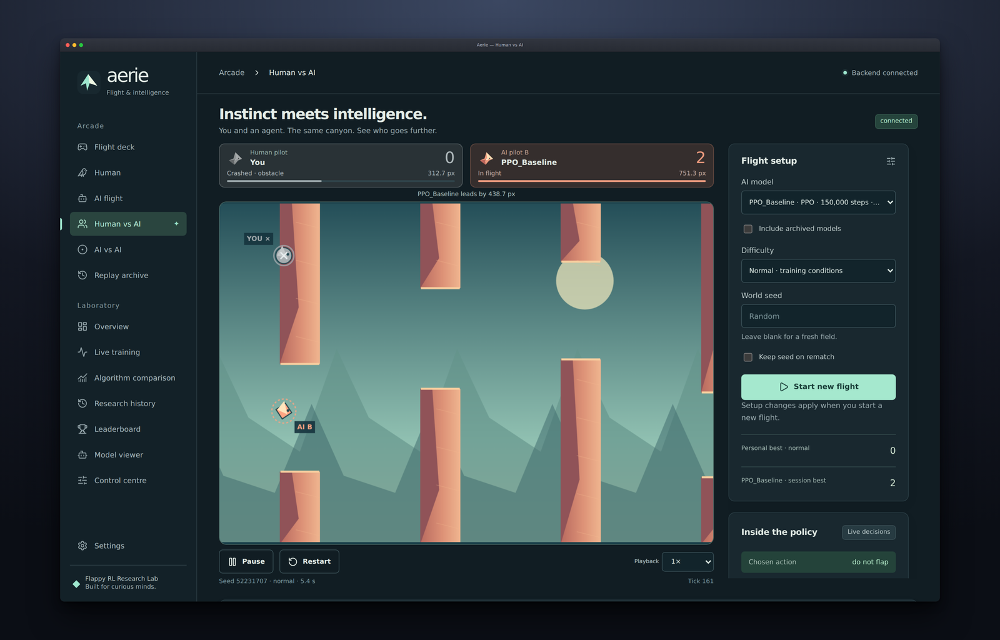
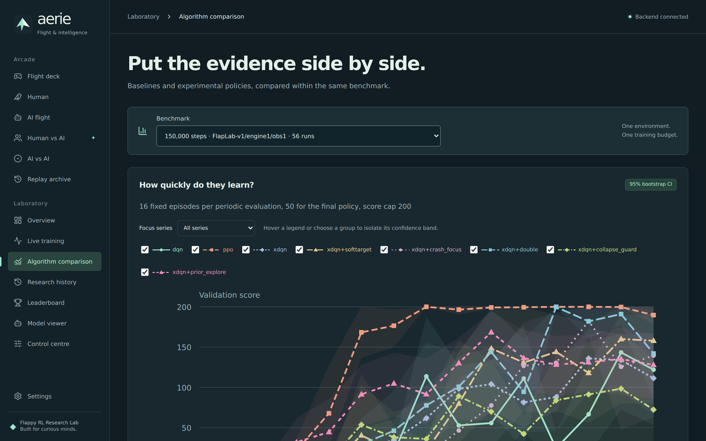
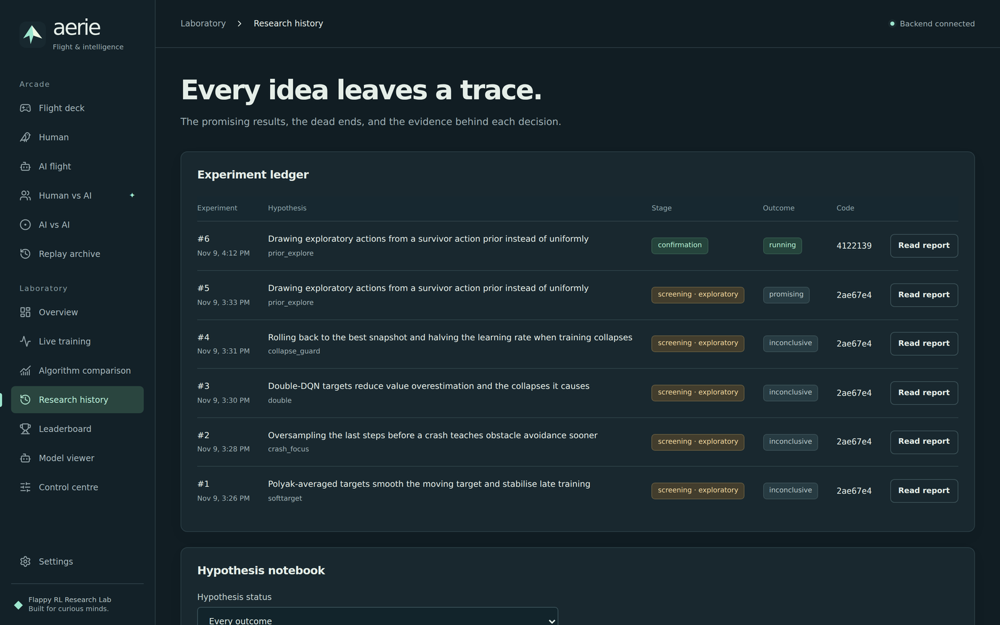

<div align="center">

<h1>Flappy RL Research Lab</h1>

<p>
  <b>An original flap-through-the-gaps arcade game and a bounded, autonomous reinforcement-learning lab that share one deterministic simulation.</b><br>
  You, a trained agent, or both at once fly the same obstacle field, while a research controller tests RL ideas against baselines and records every outcome, failures included.
</p>

<p>
  <a href="#what-it-does">What it does</a> ·
  <a href="#quick-start">Quick start</a> ·
  <a href="#configuration">Configuration</a> ·
  <a href="#how-it-works">How it works</a> ·
  <a href="#status-and-limits">Status and limits</a> ·
  <a href="#license">License</a>
</p>

<p>
  
  
  
  
  
  
</p>



</div>

---

## What it does

- **Play** with Space or a click, **watch** a trained agent play with its real Q-values or action
  probabilities on screen, or **compete**: Human vs AI and AI vs AI in the same world, with the
  same obstacles, clock and physics. When one bird crashes the other keeps flying.
- **Train** DQN and PPO baselines (Stable-Baselines3) and an in-house DQN with isolated
  experimental variants, as bounded, resumable, headless runs.
- **Research**: a controller observes the stored results, picks a hypothesis, validates its
  implementation, trains candidate and control under equal budgets, decides by a fixed statistical
  rule and writes a report.
- **Compare** algorithms on sample efficiency, final score, stability across seeds, held-out
  generalization and compute cost, never on one lucky run.



## Quick start

Python 3.11+ and about 6 GB of disk (PyTorch with its CUDA libraries on Linux). Node is only needed if you change the UI.

```bash
git clone https://github.com/jalv92/flappy-rl-research-lab.git
cd flappy-rl-research-lab
python3 -m venv .venv
.venv/bin/pip install -e .                 # Windows: .venv\Scripts\pip install -e .
.venv/bin/python -m scripts.lab serve      # then open http://127.0.0.1:8000
```

The first start unpacks the shipped lab from `seed/`: eight ready-to-fly agents (`PPO_Baseline`,
`DQN_Baseline`, `XDQN_PriorExplore`, …), 62 finished training runs with their learning curves, and
six experiment reports. Nothing has to be trained before you can play against an agent.
With [`uv`](https://docs.astral.sh/uv/): `uv venv .venv && uv pip install --python .venv/bin/python -e .`
On Debian/Ubuntu, if `python3 -m venv` complains about `ensurepip`, run `sudo apt install python3-venv` first (or use `uv`).

Going further:

```bash
.venv/bin/pip install -e ".[dev]" && .venv/bin/python -m pytest -q   # backend suite (~1 min; trains tiny real models)
.venv/bin/python -m scripts.lab status             # groups, best verified model, hypothesis statuses
.venv/bin/python -m scripts.lab bench              # measure CPU vs CUDA and cache the faster device
.venv/bin/python -m scripts.lab baselines          # retrain the reference agents (15 runs)
.venv/bin/python -m scripts.lab research --profile experimental_screening   # one bounded research session
cd frontend && npm install && npm run dev          # UI with hot reload on http://localhost:5173
```

Verified from a fresh clone on Ubuntu 24.04 under WSL2 (Windows 11 host) with Python 3.12 and PyTorch 2.15. Native
Windows and macOS are untested. Training runs on CPU by default: for these small networks it
measured about twice as fast as an RTX 4070 Ti SUPER.

## Configuration

Budgets and resource limits live in [`configs/profiles.toml`](configs/profiles.toml): concurrent
trainers, memory, GPU memory, disk, wall-clock, steps, seeds, checkpoint frequency. Five profiles:
`quick_smoke`, `baseline_benchmark`, `experimental_screening`, `full_research`,
`final_confirmation`. Optional environment variables are listed in [`.env.example`](.env.example).

Everything the lab learns is stored in `experiments/lab.db` and `checkpoints/`, so a restart loses
nothing. Both are machine-local and gitignored; `seed/` is the published snapshot they start from
(`python -m scripts.export_seed` rebuilds it).

## How it works

One engine, [`backend/game/engine.py`](backend/game/engine.py), steps every mode: human play, AI
play, competitions, training and evaluation. The server owns the simulation and streams a snapshot
per tick over a WebSocket; the browser renders and sends inputs. A match is a pure function of
`(seed, inputs)`, so every game is exactly replayable and both competitors always face the same
field.



- [`docs/architecture.md`](docs/architecture.md): simulation, environment spec, processes, storage
- [`docs/research-methodology.md`](docs/research-methodology.md): splits, metrics, controls, novelty policy
- [`docs/experiment-protocol.md`](docs/experiment-protocol.md): the experiment cycle, stages, decision rule, budgets
- [`docs/api-contracts.md`](docs/api-contracts.md): REST + WebSocket contract
- [`docs/codex-integration.md`](docs/codex-integration.md): frontend ownership and brief

## Status and limits

What is verified, the full research log and the known limits: [`docs/PROGRESS.md`](docs/PROGRESS.md).

Baseline benchmark (150,000 environment steps, 5 training seeds each, validation score = obstacles
cleared, capped at 200; final policy on 50 fixed worlds):

| Algorithm | Final mean [95% CI over seeds] | Learning-curve AUC | Collapses per run | Sample |
|---|---|---|---|---|
| PPO (SB3) | 188.3 [172.9, 199.2] | 0.67 | 0.0 | 5 seeds |
| DQN (SB3) | 124.1 [48.9, 194.9] | 0.24 | 4.0 | 5 seeds |
| xdqn (in-house control) | 123.9 [48.9, 197.4] | 0.33 | 3.4 | 5 seeds |

First research sessions (6 experiments, all recorded): four DQN modifications were inconclusive at
5 seeds; one, drawing exploratory actions from a "survivor" action prior, was confirmed with 8 fresh
seeds to learn faster than the control (AUC +0.167, 95% CI [+0.103, +0.229]) at the same compute,
without improving the final policy. PPO remains the best verified model.

- Nothing here is claimed to be a new algorithm. Every hypothesis names its closest prior work and
  is marked `known` or `unverified`.
- One environment with a 12-value observation; the score cap saturates strong agents.
- Training is seeded but not bit-reproducible across machines; conclusions rest on several seeds.
- The API has no authentication and binds to `127.0.0.1`. No paid or remote compute is ever used.

## How it was built

The backend, the research system and the integration tests were written with Claude Code; the whole
frontend was written by Codex. They collaborated through
[claude-codex-bridge](https://github.com/jalv92/claude-codex-bridge): a contract and real captured
fixtures go one way, an implementation comes back, and each round is checked in a browser.

## License

[MIT](LICENSE). The game art is original and drawn in code (`frontend/src/game/`).
